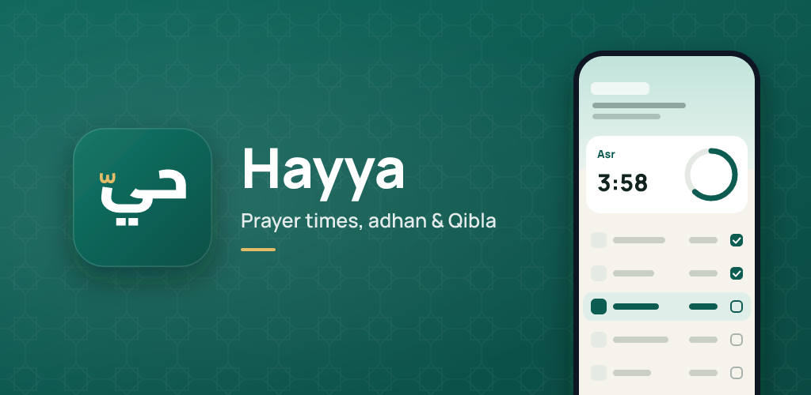
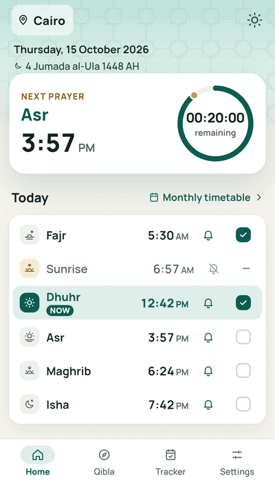
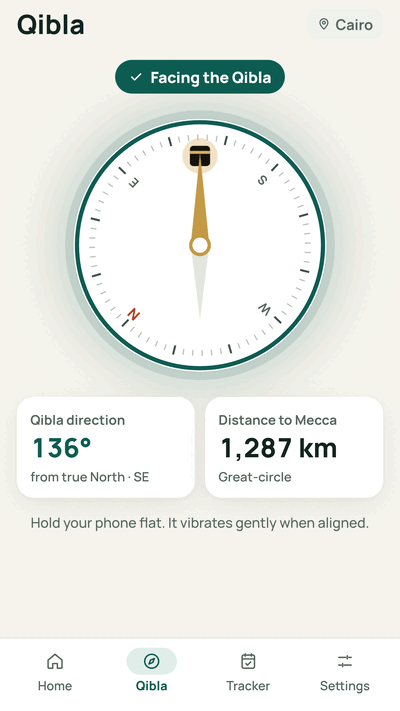
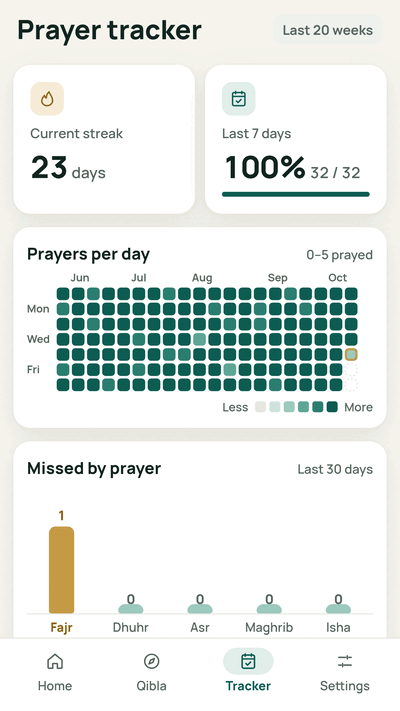
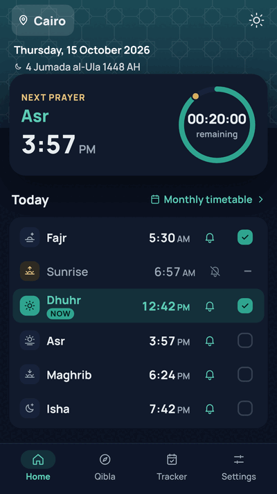
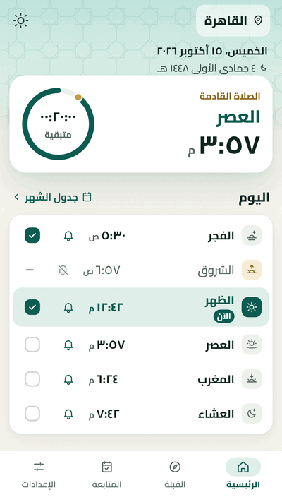
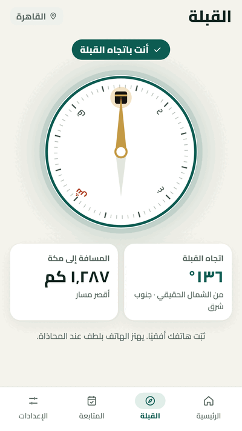
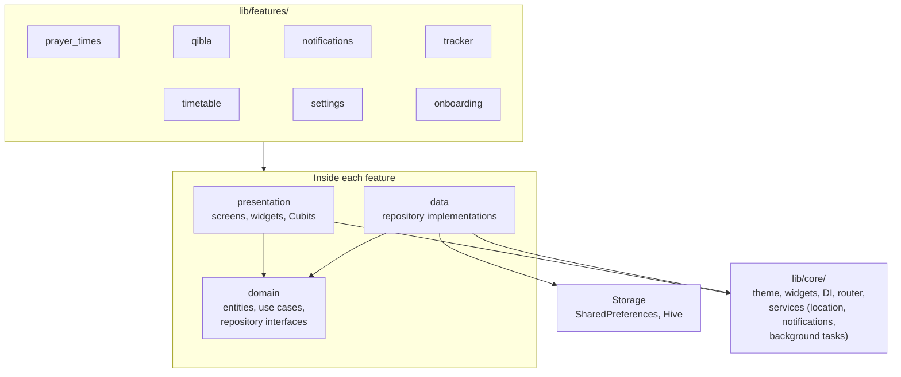

<h1 align="center">Hayya (حيّ)</h1>

<p align="center">
  An offline prayer times, adhan and Qibla app for Android, in English and Arabic, built with Flutter.
</p>

<p align="center">
  <b>Status:</b> in closed testing on Google Play, not yet public.
</p>

<p align="center">
  
  
  
  
</p>

<p align="center">
  
  
  <br>
  <sub>The same screens in Arabic, laid out right to left.</sub>
</p>

## Features

- **Prayer times** for your location, with the next prayer and a live countdown.
  Choose the calculation method, the Asr madhab, a high-latitude rule and
  per-prayer minute adjustments.
- **Adhan notifications** for each prayer, with an optional reminder before it.
- **Qibla compass** corrected to true north, with guidance when the compass
  needs calibrating or the device has none.
- **Prayer tracker**: mark prayers as prayed, see your streak, a heatmap and
  missed prayers, and count prayers to make up (qada).
- **Monthly timetable** with Gregorian and Hijri dates.
- **Onboarding** that explains each permission before the system asks; every
  step can be skipped, and you can pick a city instead of sharing location.
- **Settings** for language, light/dark theme, Arabic-Indic or Western numerals,
  12/24-hour time, location and Hijri date adjustment.
- Phone and tablet layouts.

## Technical highlights

- **Offline prayer calculation.** Times are computed on the device with the
  [`adhan`](https://pub.dev/packages/adhan) library; no prayer-time API.
- **True-north Qibla.** Android compasses report magnetic north, so the app
  adds the local magnetic declination from its own implementation of the
  World Magnetic Model (WMM2025). It is tested against all 100 of NOAA's
  official test values and against NOAA's online calculator for four cities.
  iOS already reports true north and is not corrected twice.
  ([details](docs/magnetic-declination.md))
- **Reliable adhan.** The adhan plays on Android's alarm stream, so it is heard
  even when notification volume is low. Scheduled alarms are restored after a
  reboot or app update, and a daily WorkManager task tops up the schedule in a
  headless isolate for people who rarely open the app, reusing the app's own
  scheduler rather than a copy. ([details](docs/background-reschedule.md))
- **Full RTL and text scaling.** Every layout uses directional widgets, all
  strings and numbers are localized, and every screen works at system font
  sizes up to 2.0×, enforced by an automated test matrix (see [Testing](#testing)).
- **Privacy by construction.** No accounts, ads, analytics or crash reporting.
  The release build doesn't request the `INTERNET` permission; the only network
  use is place-name lookup through the system geocoder.
  ([privacy policy](docs/privacy-policy.md))

## Architecture

Feature-first clean architecture: each feature has its own `data`, `domain`
and `presentation` layers, and shared code lives in `lib/core/`. State is held
in Cubits (`flutter_bloc`), dependencies are wired with `get_it`, and routing
uses `go_router`.



The full set of rules (strings, `context.format`, directional widgets, text
scaling, testing and git workflow) is in [docs/conventions.md](docs/conventions.md).

## Tech stack

| Area | Packages |
| --- | --- |
| Framework | Flutter, Dart |
| State and DI | `flutter_bloc` (Cubit), `get_it`, `equatable` |
| Navigation | `go_router` |
| Localization | `easy_localization`, `intl`, `hijri` |
| Prayer times | `adhan` |
| Location and compass | `geolocator`, `geocoding`, `flutter_compass`, `permission_handler` |
| Notifications and background work | `flutter_local_notifications`, `timezone`, `flutter_timezone`, `workmanager` |
| Storage | `shared_preferences`, `hive_ce` |
| UI | `flutter_screenutil`, `google_fonts` (bundled Manrope and Cairo), `fl_chart`, `flutter_svg`, `lottie`, `skeletonizer`, `percent_indicator` |
| Testing | `flutter_test`, `flutter_lints` |

## Testing

Over 900 tests (unit, Cubit, widget and full-app tests), all running headless
with `flutter test`. 320 of them are the text-scale matrix.

The **text-scale matrix** (`test/text_scale_test.dart`) renders every screen,
sheet and state at 1.0×, 1.3×, 1.6× and 2.0× text, in English and Arabic, on
five screen sizes. It fails on overflow, truncated or clipped text, words
broken mid-word, and text drawn smaller than at 1.0×.

```sh
# While working: everything except the text-scale matrix (about 2.5 min).
flutter test --exclude-tags text-scale

# Before every commit and PR: the full suite (about 10 min).
flutter test
```

## Getting started

```sh
flutter pub get
flutter run
```

Debug builds need nothing else. Release builds are signed with an upload key
read from `android/key.properties`, which isn't in the repository; without it a
release build stops with an error. See [docs/release.md](docs/release.md).

## Documentation

- [Conventions](docs/conventions.md): architecture, localization, layout and
  text scaling, testing and git workflow. Read this before contributing.
- [Magnetic declination](docs/magnetic-declination.md): the WMM2025 model behind
  the Qibla compass, and how to replace it before it expires at the end of 2029.
- [Background reschedule](docs/background-reschedule.md): the daily task that
  keeps the adhan scheduled.
- [Adhan sounds](docs/adhan-sounds.md): how the notification sounds are made
  for each platform.
- [Releasing](docs/release.md): signing, building and archiving symbols.
- [Play Data safety](docs/play-data-safety.md): the answers given to Google Play.
- [Privacy policy](docs/privacy-policy.md) ([Arabic](docs/privacy-policy.ar.md)).

## Privacy policy

Published at <https://ahmed-waheed1.github.io/hayya-privacy/>.

## Author

**Ahmed Waheed**: [GitHub](https://github.com/ahmed-waheed1) · [LinkedIn](https://www.linkedin.com/in/ahmed-waheed11)

## License

Copyright © 2026 Ahmed Waheed. All rights reserved.

The source is published for review only. No license is granted to use, copy,
modify or distribute it. See [LICENSE](LICENSE).
